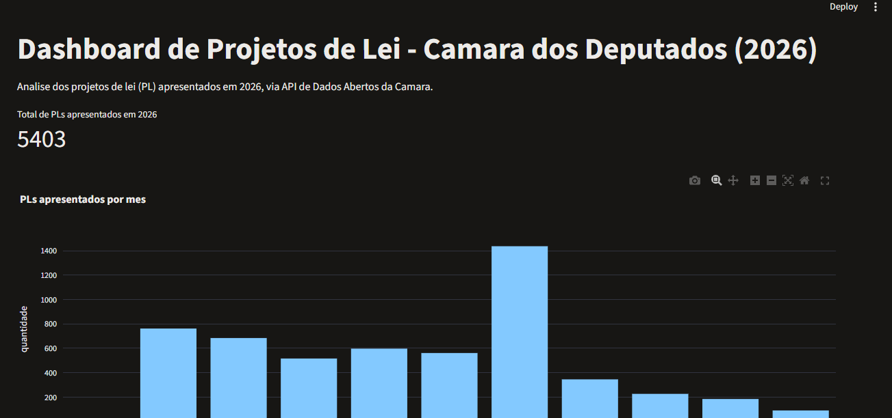
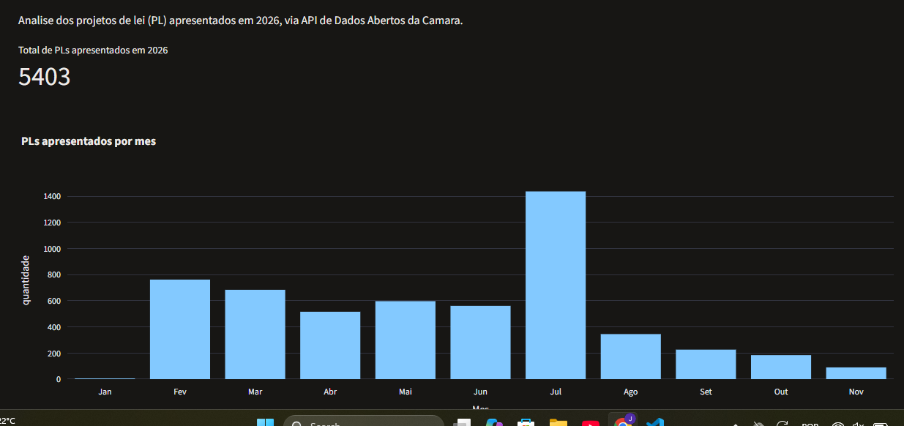
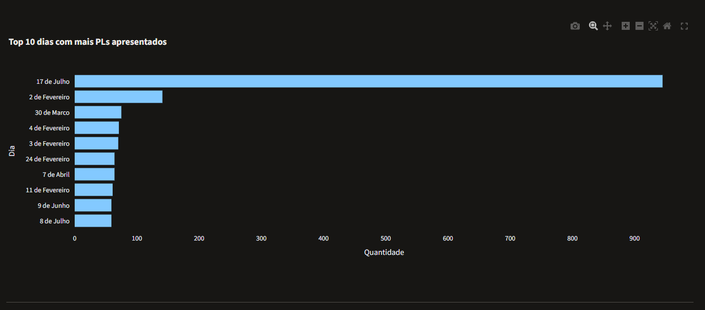
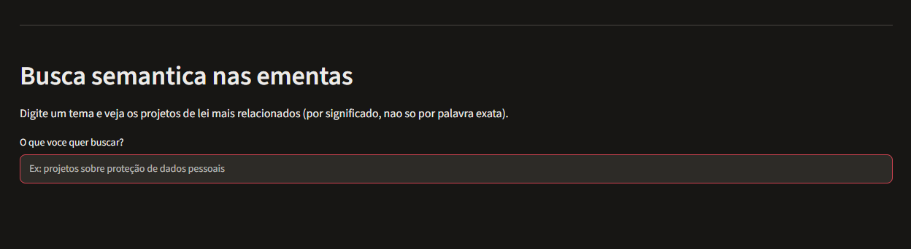

   # Análise Documental de Proposições Legislativas

Projeto em Python para coletar, analisar e pesquisar semanticamente projetos de lei apresentados na Câmara dos Deputados. A aplicação reúne dados da API de Dados Abertos da Câmara, indicadores descritivos, um dashboard interativo e uma busca semântica baseada em embeddings.

> **Recorte dos dados incluídos:** o arquivo `data/proposicoes.csv` contém 5.403 projetos de lei (`PL`), com datas de apresentação entre 2 de janeiro e 11 de novembro de 2026. Esse conjunto representa a coleta realizada até 11/11/2026; não deve ser interpretado como o total definitivo de proposições de todo o ano.

## Capturas de tela

### Visão geral do dashboard


### Projetos de lei por mês


### Top 10 dias com mais PLs apresentados


### Busca semântica nas ementas


## Funcionalidades

- **Coleta de dados:** consulta a API de Dados Abertos da Câmara dos Deputados, filtrando proposições do tipo `PL` por intervalos de datas e percorrendo as páginas disponibilizadas pela API.
- **Indicadores descritivos:** calcula a quantidade de projetos de lei por mês, identifica os dez dias com maior número de apresentações e exibe uma amostra das proposições apresentadas em 17/07/2026.
- **Dashboard interativo:** apresenta o total de projetos de lei, a distribuição mensal e os dez dias com maior volume de apresentações, utilizando Streamlit e Plotly.
- **Busca semântica:** transforma as ementas em vetores numéricos (*embeddings*) com o modelo multilíngue `paraphrase-multilingual-MiniLM-L12-v2`, armazena-os localmente no ChromaDB e recupera as ementas mais próximas de uma consulta textual.

> **Escopo da funcionalidade de IA:** a implementação atual faz recuperação semântica de documentos. Ela ainda não utiliza um modelo de linguagem (LLM) para gerar respostas a partir dos documentos; portanto, não é um sistema RAG completo (*Retrieval-Augmented Generation*).

## Estrutura do projeto

```text
analise-documental-ia/
├── data/
│   ├── proposicoes.csv       # Conjunto de dados coletado da API
│   ├── chroma_db/            # Banco vetorial gerado localmente (ignorado pelo Git)
│   └── .gitkeep
├── src/
│   ├── app.py                # Dashboard Streamlit
│   ├── buscar_dados.py       # Coleta de proposições pela API
│   ├── indicadores.py        # Cálculo dos indicadores descritivos
│   ├── busca_semantica.py    # Geração e armazenamento dos embeddings
│   ├── fazer_busca.py        # Consulta à coleção vetorial
│   └── .gitkeep
├── venv/                     # Ambiente virtual local (ignorado pelo Git)
├── .gitignore
├── requirements.txt
└── README.md
```

Os caminhos dos arquivos nos scripts são relativos à raiz do projeto. Por isso, execute os comandos a partir da pasta `analise-documental-ia`, e não de dentro de `src/`.

A pasta `data/chroma_db/` é criada durante a indexação semântica. Ela não precisa ser enviada ao GitHub: o banco pode ser reconstruído a partir do CSV e do modelo de embeddings. O arquivo `data/proposicoes.csv`, por outro lado, é utilizado pelo dashboard e pelos scripts de análise.

## Tecnologias utilizadas

- **Python** — linguagem de programação.
- **Requests** — comunicação HTTP com a API da Câmara dos Deputados.
- **Pandas** — leitura, organização e análise dos dados tabulares.
- **Streamlit** — criação do dashboard.
- **Plotly Express** — visualização dos indicadores em gráficos.
- **Sentence Transformers** — geração dos embeddings multilíngues.
- **ChromaDB** — persistência e consulta dos vetores por similaridade.

## Pré-requisitos

- Python 3 e `pip` instalados.
- Acesso à internet para consultar a API e, na primeira execução da busca semântica, baixar o modelo de embeddings.

As versões diretas das bibliotecas listadas em `requirements.txt` correspondem às versões instaladas e utilizadas nos testes deste projeto. As dependências transitivas não estão congeladas individualmente.

## Instalação

Os comandos a seguir consideram Windows com PowerShell. Execute-os na raiz do projeto.

1. Crie o ambiente virtual:

   ```powershell
   python -m venv venv
   ```

2. Ative o ambiente virtual:

   ```powershell
   .\venv\Scripts\Activate.ps1
   ```

3. Instale as dependências:

   ```powershell
   python -m pip install --upgrade pip
   pip install -r requirements.txt
   ```

4. (Opcional) Verifique as dependências instaladas:

   ```powershell
   python -m pip check
   ```

## Como executar

Todos os comandos abaixo devem ser executados na raiz do repositório, com o ambiente virtual ativado.

### Dashboard

Para iniciar a aplicação:

```powershell
streamlit run .\src\app.py
```

O Streamlit exibirá um endereço local, normalmente `http://localhost:8501`, que pode ser aberto no navegador. O dashboard lê `data/proposicoes.csv` e apresenta o total de registros, a quantidade de PLs por mês e os dez dias com mais apresentações.

### Indicadores no terminal

Para calcular e imprimir os indicadores descritivos:

```powershell
python .\src\indicadores.py
```

O script mostra o total de proposições, a distribuição mensal, os dez dias com mais apresentações e uma amostra de ementas de 17/07/2026.

### Coleta/atualização dos dados

Para executar novamente a coleta pela API:

```powershell
python .\src\buscar_dados.py
```

O script salva o resultado em `data/proposicoes.csv`. Os intervalos de datas estão definidos na lista `periodos`, dentro de `src/buscar_dados.py`; no recorte versionado para este projeto, o período final é 11/11/2026. A execução substitui o CSV existente, portanto faça uma cópia do arquivo antes de coletar novamente caso queira preservar o conjunto atual.

### Geração do banco vetorial

Para gerar os embeddings das ementas e armazená-los no ChromaDB:

```powershell
python .\src\busca_semantica.py
```

O script lê `data/proposicoes.csv`, utiliza o modelo `paraphrase-multilingual-MiniLM-L12-v2` e persiste a coleção `proposicoes` em `data/chroma_db/`. Na primeira execução, o download do modelo pode levar algum tempo. O processamento das 5.403 ementas foi concluído nos testes realizados.

Se o CSV for alterado, execute novamente a etapa de indexação para refletir os dados no banco vetorial. A coleção não é sincronizada automaticamente com mudanças no arquivo CSV.

### Consulta semântica

Depois de gerar o banco vetorial, execute:

```powershell
python .\src\fazer_busca.py
```

O script carrega o mesmo modelo de embeddings, consulta a coleção `proposicoes` e apresenta os três resultados mais próximos da pergunta definida na variável `pergunta`, em `src/fazer_busca.py`. Edite essa variável para testar outros temas.

A distância retornada pelo ChromaDB é uma medida de distância vetorial, não uma porcentagem de relevância. Para uma mesma consulta e configuração, valores menores indicam resultados mais próximos.

## Fonte dos dados

Os dados são obtidos pela [API de Dados Abertos da Câmara dos Deputados](https://dadosabertos.camara.leg.br/api/v2/proposicoes). A coleta filtra proposições pela sigla `PL` e utiliza os campos retornados pela API, incluindo identificador, número, ano, ementa e data de apresentação.

A busca semântica é realizada sobre as **ementas** das proposições; o projeto não baixa nem indexa o conteúdo integral de cada projeto de lei.

## Testes realizados

Na validação local registrada para este projeto, foram realizados os seguintes testes:

- compilação dos arquivos Python de `src/` com `python -m compileall`;
- verificação de dependências com `python -m pip check` e importação das seis bibliotecas principais;
- requisição de teste à API da Câmara, com resposta HTTP 200;
- verificação do CSV: 5.403 registros, oito colunas, sem valores ausentes, sem IDs duplicados, com datas válidas e ementas preenchidas;
- execução de `indicadores.py` e comparação de seus totais com o CSV;
- geração dos embeddings em duas execuções, mantendo 5.403 registros na coleção ChromaDB;
- consulta semântica de exemplo, com retorno de três ementas relacionadas à educação;
- abertura do dashboard Streamlit e conferência visual dos indicadores e gráficos.

Esses testes validam o funcionamento no ambiente local utilizado. Eles não substituem uma suíte automatizada de testes nem garantem que a API externa estará sempre disponível.

## Limitações e possibilidades de evolução

- Os intervalos de coleta são definidos manualmente em `buscar_dados.py` e precisam ser atualizados para abranger novos períodos.
- Os indicadores e o dashboard são descritivos e temporais; ainda não há classificação automática de proposições por assunto.
- A busca semântica é executada separadamente do dashboard e utiliza uma pergunta definida diretamente no código.
- A aplicação recupera documentos por similaridade, mas ainda não gera respostas com um LLM. A geração de respostas com contexto recuperado pode ser desenvolvida como uma etapa futura de RAG.
- A persistência local do ChromaDB fica em `data/chroma_db/` e é ignorada pelo Git; cada pessoa que clonar o projeto deverá gerar o próprio banco vetorial.

## Licença

Este repositório ainda não declara uma licença. Adicione um arquivo de licença caso queira definir formalmente as permissões de uso, modificação e redistribuição do projeto.
